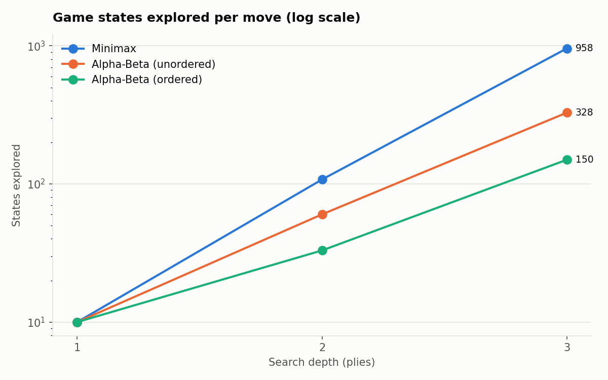
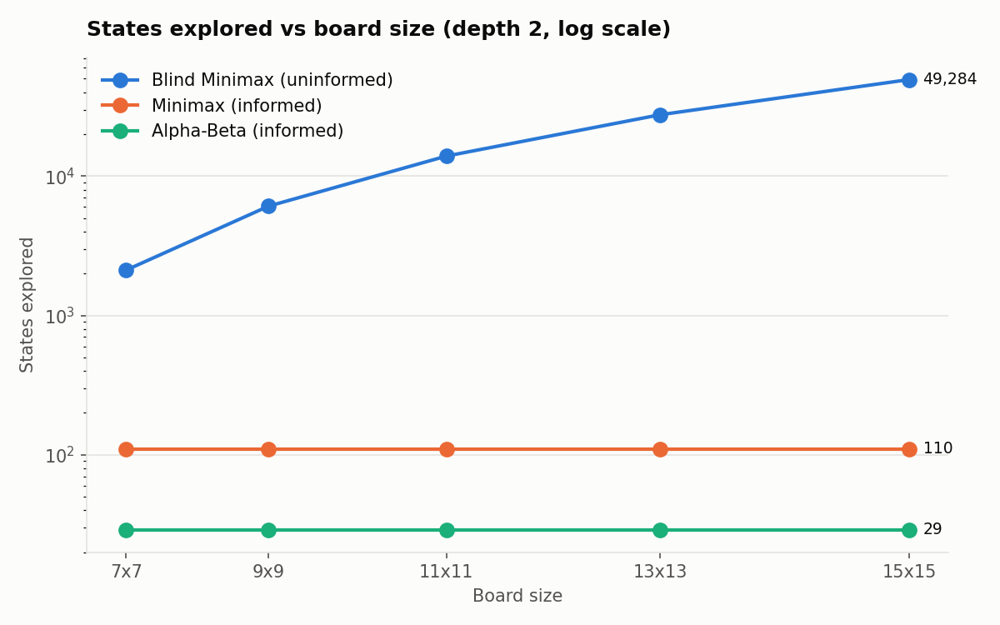
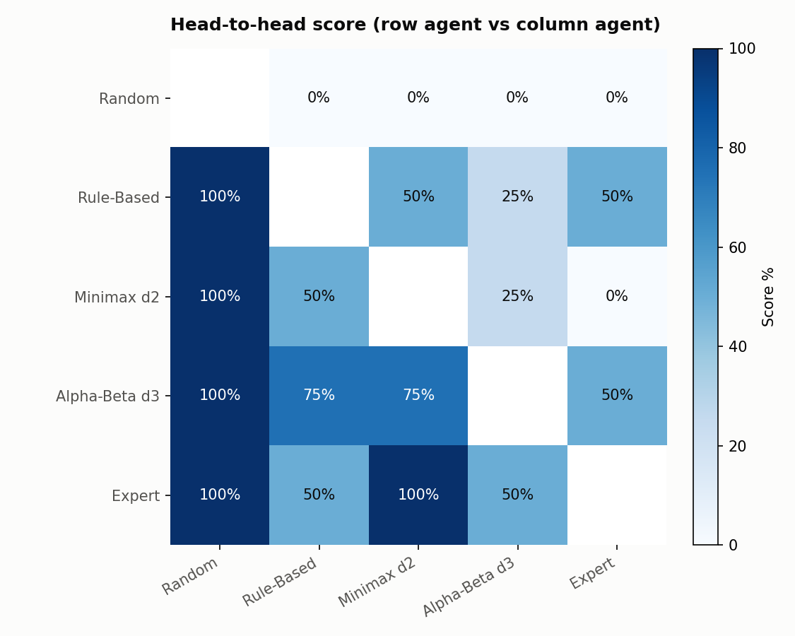

# 🎮 Intelligent Gomoku Game

An **AI course project** that builds a 15×15 Gomoku (Five-in-a-Row) game and uses it as an
experimental environment for classical AI techniques. The computer opponent goes through the full
progression described in the project synopsis, **Random → Rule-Based → Minimax → Minimax with
Alpha-Beta Pruning**, plus an advanced **Iterative Deepening + Transposition Table** agent. A
benchmark compares them on playing strength, decision time, search depth and number of game states
evaluated.

**Team:** Harsha Anvitha (240469) · Himanshi (240475) · Ketan (240510)

---

## 🙏 Acknowledgements & Contributions

This project builds on an earlier Gomoku project by a senior
([karthik14344/Gomuku](https://github.com/karthik14344/Gomuku)), which provided the Tkinter GUI,
Player vs Player mode, move suggestions and the rule-based / XGBoost post-game coaches.

**Our contributions:**
- A new AI engine (`agents.py`): separate Random, Rule-Based, Minimax and Alpha-Beta agents, an
  Expert agent with iterative deepening and a Zobrist transposition table, a pattern-based heuristic,
  candidate move generation, and search statistics plus a plain-English reason for every move
- Integration into the game: four difficulty levels, a live AI decision panel, draw detection,
  winning-line highlight, a fixed Undo, and richer CSV logging (board state, AI decision info)
- AI Vs AI mode (`ai_vs_ai.py`)
- Experiments (`benchmark.py`, `results/`) and the Pandas analysis notebook (`analysis/`)
- Unit tests (`tests/`, 32 tests)
- Bug fixes (crash without xgboost, debug output) and updated documentation

---

## 🎯 Theme: AI for Human Insight and Capability Enhancement

The goal is not an AI that just beats people. The goal is an AI that **helps people get better at a
thinking game**. A child (or any beginner) plays Gomoku, and the AI turns every game into feedback
they can understand and act on:

| How the AI helps the human | Where |
|---|---|
| **Teaches** the ideas step by step and checks the answers | 🎓 Learn → Lessons (AI-checked, with hints and explanations) |
| **Invents new practice problems** from its own games | 🎓 Learn → AI puzzles |
| **Coaches every move** while you play (great / careful / mistake + a better square) | 🎓 "Coach me" in every game |
| **Explains its own thinking** (the moves it compared and why it chose one) | AI panel + numbered circles on the board |
| **Grades** each game (accuracy %, A+ to D) and lists strong moves and mistakes | Result screen |
| **Finds patterns** in your games (most common mistake, improvement trend, colour results) | 🏆 Scoreboard → "What the AI noticed about you" |
| **Adapts** to you: fuzzy logic judges your skill and picks a robot that's just right | 🎯 Smart Match, result screen |
| **Shows how AI works** with live experiments | 🧠 AI Lab |

## 📋 Assessment criteria → where they are in the project

| Criterion (guidelines) | In the project |
|---|---|
| 1. Problem statement | Theme section above, synopsis section 2 |
| 2. State space search | AI Lab → **Problem formulation** (state, initial state, actions, transition model, goal test, utility, path cost, strategy, filled in live from your game) · `tutor.formulate()` · Blind / Minimax / Alpha-Beta / Expert agents in `agents.py` · AI Lab → Search and States vs size |
| 3. Knowledge representation | Production rules (`RuleBasedAgent`), pattern knowledge base (`PATTERNS` weights), board as a matrix and lines as pattern strings (`agents.py`); fuzzy rule base (`fuzzy_logic.RULES`) |
| 4. Intelligent system design | Browser UI → Flask API (`web_app.py`) → agents / analysis / tutor / fuzzy modules → SQLite (`player_db.py`) |
| 5. **Fuzzy logic** | `fuzzy_logic.py`: Mamdani inference (3 inputs, 2 outputs, 12 rules, centroid). Used by Smart Match and the post-game coach; AI Lab → **Fuzzy logic** shows every step with sliders |
| 6. Other AI techniques | Heuristic evaluation, iterative deepening, transposition table (Zobrist hashing), move ordering, XGBoost ML coach (`gomoku_ml_coach.py`, desktop app), Elo rating |
| Bonus: originality | AI Tutor with AI-generated puzzles, live coach, visible AI thinking, AI Lab with live experiments, fuzzy Smart Match, AI-graded games |
| Bonus: ethics (bias & fairness) | First-move bias measured and corrected (colour-swapped Robot Battle, colour-fair rating), live bias test, transparency, privacy (local data only, **delete my data**), AI Lab → **Fairness & ethics** |

## 🧭 Synopsis → Implementation

| Synopsis requirement | Where it is implemented |
|---|---|
| 15×15 board, alternating turns, win / draw detection (7.1, 7.2) | `agents.py` (rules), `single_player.py`, `player_vs_player.py` |
| Random AI (7.3) | `RandomAgent` in `agents.py` (**Easy**) |
| Rule-Based AI: win, block, deny threats, build patterns, counter-attack (7.4) | `RuleBasedAgent` (**Medium**), every move reports which rule fired |
| Minimax (7.5) | `MinimaxAgent` (heuristic, no pruning) and `BlindMinimaxAgent`: the **unguided, uninformed** minimax of section 5.3 (win/loss/draw only) |
| Alpha-Beta Pruning (7.6) | `AlphaBetaAgent` (**Hard**), with and without move ordering |
| Heuristic evaluation: 2/3/4 in a row, open ends, threats, board control (7.7) | `evaluate()`, `PATTERNS`, `move_score()` in `agents.py` |
| Candidate move generation (7.8) | `candidate_cells()` / `generate_moves()`: 225 cells → ~10-40 |
| AI decision process (7.9) | `Agent.choose_move()` + live **AI decision** panel in the GUI |
| Difficulty levels (7.10) | Easy / Medium / Hard / **Expert** dropdown |
| Game analysis: missed wins, failed defence, strong moves (7.11) | `gomoku_coach.py`, `gomoku_ml_coach.py`, post-game summary window |
| Data collection: timestamp, player, move, board state, duration, difficulty, AI decision info, result (8) | `games/*.csv`, `results/tournament_moves.csv`, and the SQLite player database `data/gomoku.db` (`player_db.py`) |
| Benchmark strategies against each other (Objectives) | `benchmark.py` → `results/` CSVs and charts |
| Data analysis with Pandas / Jupyter (9) | `analysis/gomoku_analysis.ipynb` |
| AI-vs-AI games (Future scope) | **Robot Battle** (web) and **AI Vs AI** (`ai_vs_ai.py`) pages, plus the tournament |
| Agent & environment, PEAS, vacuum-world comparison (5.1, 5.2) | **AI Lab** in the web game: Agent, Environment and Agent-types tabs; each agent class declares its `agent_type` |
| Uninformed vs informed search (5.3) | `BlindMinimaxAgent` vs `MinimaxAgent` / `AlphaBetaAgent`; live experiment in AI Lab → Search |
| State space grows with problem size (5.4) | Boards from 9×9 to 15×15; benchmark experiment 3 (`results/state_space.png`); AI Lab → States vs size |
| Heuristic function (7.7) | AI Lab → Heuristic: build a position and see every pattern, weight and the score |
| Testing (Phase 10) | `tests/` (119 tests: rules, agents, board sizes, web API, analysis, grading, ratings, fuzzy logic, tutor, fairness, privacy) |

---

## 📋 Table of Contents

- [Features](#features)
- [Project Overview](#project-overview)
- [Installation](#installation)
- [Quick Start](#quick-start)
- [Game Modes](#game-modes)
- [How to Play](#how-to-play)
- [AI Difficulty Levels](#ai-difficulty-levels)
- [Architecture](#architecture)
- [Project Structure](#project-structure)
- [Core Components](#core-components)
- [Game Analysis & Coaching](#game-analysis--coaching)
- [Data & Machine Learning](#data--machine-learning)
- [Requirements](#requirements)
- [Troubleshooting](#troubleshooting)
- [Contributing](#contributing)
- [License](#license)

---

## ✨ Features

### Gameplay
- **15×15 Gomoku Board** - Classic game configuration
- **Two Game Modes**:
  - Single Player vs AI with adjustable difficulty
  - Player vs Player (local multiplayer)
- **Real-time Move Suggestions** - AI-powered hints during gameplay
- **Game Timer** - Tracks total game duration
- **Move History** - Complete move logging and replay capability
- **Win Detection** - Automatic 5-in-a-row detection

### AI & Strategy
- **Four difficulty levels**, each a different AI technique:
  - **Easy**: Random agent (uninformed baseline)
  - **Medium**: Rule-based tactical agent
  - **Hard**: Minimax with alpha-beta pruning, depth 3, move ordering
  - **Expert**: Iterative deepening alpha-beta with a Zobrist transposition table (2 s per move)
- **Pattern-based heuristic**: fives, open/closed fours, open/closed threes, twos, plus tactical rules
- **Candidate move generation**: only cells within 2 of a stone, ranked by attack + defence value
- **Explainable moves**: the AI panel shows states searched, depth, time and the reason for each move
- **AI Vs AI mode** and a **benchmark tool** for experiments

### Coaching & Analysis
- **Rule-based Game Analysis**:
  - Detects missed winning moves
  - Identifies failed defensive plays
  - Analyzes board strategy
  - Provides actionable feedback
- **ML-powered Coaching**:
  - Machine learning model trained on game data
  - Personalized move quality predictions
  - Pattern recognition for common mistakes
  - Auto-retraining on new games

### User Interface
- **Modern Tkinter Design** - Clean, responsive layout
- **Navigation Menu** - Seamless switching between modes
- **Move Suggestions Overlay** - Interactive hint display
- **Game Statistics** - Score tracking and performance metrics
- **Inactivity Alerts** - Reminds players of long pauses

### Data Tracking
- **Automatic Game Recording** - CSV format with timestamps
- **Game Analytics** - Stored in `games/` folder for analysis
- **Performance Metrics** - Tracks wins, losses, and strategy effectiveness

---

## 🎯 Project Overview

Gomoku (also known as Five-in-a-Row or Renju) is an abstract strategy board game where two players take turns placing stones on a 15×15 board. The first player to create an unbroken line of five stones horizontally, vertically, or diagonally wins.

This project combines:
1. **Classic Game Logic** - Complete Gomoku rules implementation
2. **Intelligent AI** - Minimax with alpha-beta pruning
3. **Real-time Suggestions** - In-game move recommendations
4. **Coaching System** - Dual analysis (rule-based + ML-based)
5. **Learning Platform** - Improve through detailed feedback

---

## 📦 Installation

### Prerequisites
- Python 3.8+ (with tkinter built-in on Windows)
- pip (Python package installer)

### Linux/Mac Users
If tkinter is missing:
```bash
# Ubuntu/Debian
sudo apt-get install python3-tk

# macOS
brew install python-tk@3.x  # where x is your Python version
```

### Step 1: Clone the Repository
```bash
git clone https://github.com/karthik14344/Gomuku.git
cd Gomuku
```

### Step 2: Create Virtual Environment (Optional but Recommended)
```bash
# Windows
python -m venv venv
venv\Scripts\activate

# Linux/Mac
python3 -m venv venv
source venv/bin/activate
```

### Step 3: Install Dependencies
```bash
pip install -r requirements.txt
```

### Step 4: Verify Installation
```bash
python check_dependencies.py
```

Expected output:
```
============================================================
Gomoku ML Coach - Dependency Checker
============================================================

✓ pandas              - OK
✓ numpy               - OK
✓ xgboost             - OK
✓ scikit-learn        - OK
✓ python-dateutil     - OK
✓ tkinter             - OK

============================================================
✓ All dependencies are installed!
You can now run: python main.py
```

---

## 🚀 Quick Start

### Run the Game
```bash
python main.py
```

The home page offers **Single Player**, **Player vs Player**, **AI Vs AI** and **How To Play**.

### Play in the browser (kid-friendly web version)
```bash
python web_app.py
```
Then open **http://127.0.0.1:8050** (set the `PORT` environment variable to use another port).
The browser only draws the board; every AI move is computed in Python (`web_app.py` calls `agents.py`).

| Feature | What it does |
|---|---|
| 🗺️ **Adventure levels** | 10 levels from 9×9 to 15×15, one AI opponent and one AI idea per level; beat a level to unlock the next, earn up to 3 stars |
| 🎮 **Quick Play** | pick any opponent, board size (9/11/13/15) and who moves first |
| ⏸ **Pause menu** | Resume, Restart, Sound, How to play, Exit; the timer and the AI stop while paused |
| ▶️ **Continue** | games are saved automatically; leave at any time and continue from the home screen |
| ← **Back / Exit** | asks before leaving a game in progress |
| 💡 Hints, ↩️ Undo, ⏱ timer | 3 hints per game; undo takes back your move and the AI's reply |
| 🧠 **AI thinks before every move** | before each stone, the board shows the moves the AI compared (numbered circles, the chosen one turns green ✓); the panel lists them with their scores, plus boards searched, depth and time. Can be switched off |
| 🤖 **The AI rates your game** | after every game the AI grades your play: accuracy % (each of your moves compared with the best move available at that moment) and a grade A+ to D |
| 🏆 **Rating and Scoreboard** | a chess-style (Elo) rating per player: beat stronger robots to climb faster, play accurately for a bonus. Titles from 🪨 Pebble to 🐉 Grandmaster, a rating chart, your record against each robot, your game history and a leaderboard |
| 🎨 **Board themes** | Classic Wood, Ocean, Candy, Forest, Sunset, Space and Paper |
| 🎓 **AI Tutor** | Rules, 5 lessons the AI checks and explains (win, block, open three, open four, double attack), unlimited AI-generated puzzles, practice games with the coach |
| 🎓 **Live coach** | after each of your moves: ✅ great / 👍 good / ⚠️ careful / ❌ mistake, why, and ★ on a better square |
| 🎯 **Smart Match** | fuzzy logic reads your recent accuracy, mistakes and results and picks your next robot |
| 💡 **Player insights** | most common mistake, improvement trend, results by colour, strongest robot beaten |
| 🗑 **Delete my data** | removes a player's rating and all their games from the database |
| 📊 Post-game report | stars, great moves, mistakes, danger moments and a tip |
| 👫 Friend mode, ⚔️ Robot Battle | two players on one screen; any two AIs on any board size. Robots swap colours every game and each random opening is played twice (once with each robot as Black), so the scoreboard compares robots fairly and counts Black's first-move advantage separately |
| 🧠 **AI Lab** | the AI theory behind the game, with live experiments (see below) |

Keyboard: `P`/`Esc` pause, `H` hint, `U` undo, `R` restart. Games are saved to `games/web/`.

**How the rating works (`player_db.py`).** Each robot has a fixed rating: 🐣 Pip 600, 🦇 Batty 700,
🦊 Foxy 1100, 🐢 Turtle Max 1250, 🦉 Professor Owl 1500, 🐉 Draco 1750. New players start at 1000.
After a game, the change is the Elo formula `K × (result − expected)`, where `expected = 1 / (1 + 10^((robot − player)/400))`
and K is 48 for a player's first 10 games and 32 after that, plus an accuracy bonus of `(accuracy − 60) / 10`.
Players and games are stored in the SQLite database **`data/gomoku.db`** (tables `players` and `games`),
which stays on your computer and is not uploaded to GitHub.

**AI Lab tabs:** Problem formulation (the state-space formulation, live) · Fuzzy logic (sliders, memberships, rules, centroid) · Fairness & ethics (live bias test) · Agent (perceive-decide-act, PEAS, vacuum-world comparison) · Environment (fully
observable, deterministic, sequential, static, discrete, adversarial) · Agent types (simple reflex /
goal-based / utility-based for every robot) · Search (run blind and informed search on the same
position) · States vs size (measure how the state space grows from 7×7 to 15×15) · Heuristic
(build a position and watch the heuristic function score it).

### Run the experiments
```bash
python benchmark.py --quick        # about 1-2 minutes
python benchmark.py                # full run used for the report (a few minutes)
```
Results (CSV + PNG charts) are written to `results/`. Open `analysis/gomoku_analysis.ipynb` for the analysis.

### Run the tests
```bash
python -m pytest -q
```

---

## 🎮 Game Modes

### Single Player (vs AI)

**Features:**
- Choose AI difficulty before starting
- Receive move suggestions anytime during play
- AI responds intelligently based on difficulty level
- Automatic game saving and analysis

**Workflow:**
1. Click "Single Player" from home
2. Select difficulty (Easy/Medium/Hard/Expert)
3. Place black stones (you always go first)
4. Computer responds with white stones
5. Game ends when someone gets 5-in-a-row
6. Receive coaching feedback on your performance

**Tips:**
- Use suggestions liberally to learn strategy
- Try Expert difficulty for maximum challenge
- Play multiple games to improve your ranking

### Player vs Player

**Features:**
- Local multiplayer on single machine
- Players alternate turns
- Both players get move suggestions
- Full game history and analysis

**Workflow:**
1. Click "Player vs Player" from home
2. Black player places first stone
3. White player responds
4. Continue alternating until win condition
5. Post-game analysis available for both players

---

## 📚 How To Play

### Basic Rules
1. **Board**: 15×15 grid (225 squares)
2. **Starting**: Black player goes first (always center-ish area)
3. **Taking Turns**: Players alternate placing one stone per turn
4. **Winning**: First to create 5+ consecutive stones in any direction wins
5. **Directions**: Horizontal, vertical, or diagonal lines count

### Valid Directions for Winning
```
Horizontal:   ●●●●●
Vertical:     ●
              ●
              ●
              ●
              ●

Diagonal:     ●
                ●
                  ●
                    ●
                      ●

Anti-diagonal: ●
               ●
               ●
               ●
               ●
```

### Strategic Tips
- **Center Control**: Control the board center for tactical advantage
- **Create Threats**: Build multiple winning paths simultaneously
- **Block Opponents**: Stop their 4-in-a-row patterns
- **Pattern Recognition**: Watch for sequences of 3-4 stones
- **Early Game**: Start near center; expand outward
- **Mid Game**: Create multiple threats (opponent can't block all)
- **End Game**: Convert threats into winning moves

### Using Suggestions
- **Green Highlight**: Top recommended moves
- **⭐ WIN**: Move wins immediately
- **🛡️ BLOCK**: Defensive move to stop opponent's win
- **Score Number**: Move quality assessment (higher = better)

---

## 🤖 AI Difficulty Levels

| Level | Agent | Technique | Type of search |
|---|---|---|---|
| Easy | `RandomAgent` | Any legal move | Uninformed |
| Medium | `RuleBasedAgent` | Fixed tactical rules, 1-ply | Goal-based agent |
| Hard | `AlphaBetaAgent(depth=3)` | Minimax + alpha-beta + move ordering | Informed adversarial search |
| Expert | `ExpertAgent` | Iterative deepening + transposition table, 2 s budget | Informed, utility-based |

`MinimaxAgent` (no pruning) is also available in AI Vs AI mode and in the benchmark, to show what
pruning saves.

### Rule-Based agent (rules in priority order)
1. Win immediately
2. Block the opponent's five
3. Create an open four
4. Create a fork (four-three or double three)
5. Block the opponent's open three or fork
6. Otherwise play the cell with the best attack + defence value

### Search-based agents: decision process
```
1. Perceive the board (copy of the 15x15 state)
2. Generate candidates: empty cells within 2 of a stone
   - a winning move is played at once
   - if the opponent threatens five, only blocking cells are kept
   - otherwise rank by move_score (attack + 0.9 x defence) and keep the best N
3. Minimax over those candidates to depth d
   - leaves scored by the pattern heuristic evaluate()
   - alpha-beta prunes branches that cannot change the decision
   - Expert: iterative deepening (d = 1, 2, 3 ...) until time runs out,
     transposition table to reuse positions reached by different move orders
4. Play the move with the highest minimax value and report statistics
```

### Heuristic evaluation
Each row, column and diagonal is turned into a string (`X` own stone, `.` empty, `#` blocked) and
patterns are counted:

| Pattern | Example | Weight |
|---|---|---|
| Five | `XXXXX` | 1,000,000 |
| Open four | `.XXXX.` | 100,000 |
| Four | `XXXX.`, `XX.XX` | 10,000 |
| Open three | `.XXX..`, `.XX.X.` | 3,000 |
| Closed three | `XXX..`, `X.X.X` | 300 |
| Open two | `..XX..` | 50 |

Score = own patterns − opponent patterns, with tactical rules for the side to move (a four wins
next move, an open four cannot be stopped).

---

## 🧪 Experiments & Results

Produced by `python benchmark.py` (8 test positions; round robin, 4 games per pairing, colours
alternating, random two-stone openings). Full data in `results/`, analysis in
`analysis/gomoku_analysis.ipynb`.

### 1. Search efficiency (same positions, same candidates, same heuristic)

| Depth | Minimax states | Alpha-Beta (unordered) | Alpha-Beta (ordered) | Minimax time | Alpha-Beta (ordered) time |
|---|---|---|---|---|---|
| 1 | 10 | 10 | 10 | 6 ms | 6 ms |
| 2 | 108 | 60 | 33 | 68 ms | 51 ms |
| 3 | 958 | 328 | **150** | 1744 ms | **521 ms** |

All three returned **the same minimax value on every position**: pruning never changes the
decision. At depth 3, ordered alpha-beta explores **84% fewer states** and is about **3.3x faster**.



### 2. States vs board size: uninformed vs informed search (depth 2)

| Board | Blind Minimax (uninformed) | Minimax (informed) | Alpha-Beta (informed) |
|---|---|---|---|
| 7×7 | 2,116 | 110 | 29 |
| 9×9 | 6,084 | 110 | 29 |
| 11×11 | 13,924 | 110 | 29 |
| 13×13 | 27,556 | 110 | 29 |
| 15×15 | 49,284 | 110 | 29 |

The number of states an uninformed search must explore grows with the size of the problem (about
cells² for a 2-move look-ahead). Candidate move generation and the heuristic keep informed search
constant. There is no external dataset: the "data" is the state space itself.



### 3. Tournament

| Agent | W | L | Win % | ms / move | states / move |
|---|---|---|---|---|---|
| Alpha-Beta d3 | 12 | 4 | 75% | 271 | 143 |
| Expert (ID + TT, 1 s) | 12 | 4 | 75% | 802 | 460 |
| Rule-Based | 9 | 7 | 56% | 32 | 69 |
| Minimax d2 | 7 | 9 | 44% | 94 | 82 |
| Random | 0 | 16 | 0% | 0.1 | n/a |



**Findings.** The uninformed Random agent never wins, and any domain knowledge beats it. Informed
search with pruning (Alpha-Beta, Expert) is the strongest. Expert searches about 3x more states but
did not beat fixed-depth alpha-beta overall, which shows that heuristic quality matters as much as
search depth. The sample is small (4 games per pairing), so differences between neighbouring agents
are not statistically significant.

---

## 🏗️ Architecture

### High-Level Design
```
┌─────────────────────────────────────────┐
│         Tkinter GUI Layer               │
│  (main.py, single_player.py, etc)      │
├─────────────────────────────────────────┤
│      Game Logic & UI Controller         │
│  (Game state, move validation, display) │
├─────────────────────────────────────────┤
│    AI Engine & Algorithms               │
│  (gomoku_ai.py - evaluation & search)   │
├─────────────────────────────────────────┤
│    Analysis & Coaching Systems          │
│  (Rule-based & ML coaching)             │
├─────────────────────────────────────────┤
│    Data Layer                           │
│  (CSV files, game history)              │
└─────────────────────────────────────────┘
```

### Data Flow
```
Player Input
    ↓
Validate Move (gomoku_ai.py)
    ↓
Execute Move → Update Board
    ↓
Check Win Condition
    ├─ No Win
    │  ↓
    │  Generate AI Move (gomoku_ai.py)
    │  ↓
    │  Update Board
    │  ↓
    │  Check Win Condition
    │
    └─ Win/Draw
       ↓
       Record Game (CSV)
       ↓
       Analyze Game
       ├─ Rule-based (gomoku_coach.py)
       └─ ML-based (gomoku_ml_coach.py)
       ↓
       Provide Coaching Feedback
       ↓
       Retrain ML Model (if needed)
```

---

## 📁 Project Structure

```
Gomuku/
├── main.py                 # Entry point, home page
├── single_player.py        # Human vs AI (difficulty, AI decision panel, undo, CSV logging)
├── player_vs_player.py     # Local two-player mode
├── ai_vs_ai.py             # Watch two agents play, live search statistics
├── how_to_play.py          # Rules and tutorial page
│
├── agents.py               # AI engine: rules, heuristic, Random / Rule-Based / Minimax /
│                           #   Alpha-Beta / Expert agents, difficulty presets
├── gomoku_ai.py            # Original search + move-suggestion engine (used by hints)
├── suggestion_overlay.py   # Move-suggestion overlay UI
├── gomoku_coach.py         # Rule-based post-game analysis
├── gomoku_ml_coach.py      # XGBoost post-game coaching (optional)
│
├── benchmark.py            # Experiments: search efficiency + round-robin tournament
├── results/                # Benchmark CSVs and charts
├── analysis/               # Jupyter notebook analysing results/ and games/
├── tests/                  # pytest unit tests
├── games/                  # Recorded human games (CSV)
│
├── check_dependencies.py
└── requirements.txt
```

---

## 🔧 Core Components

### 1. gomoku_ai.py (453 lines)

**Board Analysis Functions:**
```python
get_empty_cells(state)          # Returns all empty positions
candidate_moves(state)          # Smart move candidates
neighbors_exist(state, r, c)    # Checks surrounding pieces
is_win_at(state, r, c, color)   # Detects 5-in-a-row
```

**Evaluation Functions:**
```python
evaluate(state, perspective)    # Board score calculation
score_color(state, color)       # Threat & pattern scoring
count_threat_level(...)         # Measures piece sequences
is_open_threat(...)             # Identifies dangerous patterns
```

**AI Algorithms:**
```python
ai_easy()                       # Random move selection
ai_search()                     # Minimax with pruning
suggest_moves()                 # Move recommendations
```

**Scoring System:**
- 5 in a row: **100,000** points
- Open 4: **10,000** points
- Closed 4: **3,000** points
- Open 3: **1,000** points
- Closed 3: **200** points
- Open 2: **50** points

### 2. single_player.py (1046 lines)

**Main Classes:**
```python
class GomokuGamePage:
    # Single player game controller
    # Handles UI, AI moves, game state
```

**Key Methods:**
- `create_game_board()` - Renders 15×15 board
- `on_board_click()` - Processes player moves
- `ai_move_thread()` - Executes AI move (non-blocking)
- `save_game()` - Records game to CSV
- `end_game()` - Calls coaching system

### 3. gomoku_coach.py (287 lines)

**Analysis Functions:**
```python
analyze_game_rule_based(move_log, difficulty)
    # Returns: list of move analysis with feedback

summarize_gomoku_game(move_log, difficulty)
    # Returns: human-readable coaching summary
```

**Detects:**
- ✓ Missed winning moves
- ✓ Failed defensive blocks
- ✓ Weak edge plays
- ✓ Low-value moves
- ✓ Pattern mistakes

### 4. gomoku_ml_coach.py (632 lines)

**ML Pipeline:**
```python
load_game_csvs()                # Load historical games
extract_features()              # Feature engineering
train_model()                   # XGBoost training
coach_reply()                   # Generate ML feedback
retrain_model_if_needed()       # Auto-training trigger
```

**Features Extracted:**
- Move position (row, col)
- Board state patterns
- Threat levels
- Distance to edges
- Move sequence context
- Game phase (opening/mid/end)

---

## 📊 Game Analysis & Coaching

### Rule-Based Coaching (gomoku_coach.py)

Analyzes each move using heuristic rules:

1. **Win Detection**
   ```
   Is this move a winning move?
   If yes: Suggest player should have played it!
   ```

2. **Block Detection**
   ```
   Is the opponent threatening a win?
   If yes: This move should block it!
   ```

3. **Edge Analysis**
   ```
   Is the move too close to board edge?
   Edge moves reduce strategic flexibility.
   ```

4. **Value Assessment**
   ```
   Score move by threats created and opponent threats stopped
   Compare to suggestions to rate move quality
   ```

**Output Example:**
```
Move 5: (7, 7) by Black
✗ Mistake: Missed winning opportunity at (8, 8)
Better moves: [(8,8,'win'), (6,6,'score'), (9,9,'block')]
Coaching: "Watch for immediate winning patterns - they're the highest priority!"
```

### ML-Powered Coaching (gomoku_ml_coach.py)

Machine learning analysis on move patterns:

1. **Feature Extraction**
   - Board state representation
   - Move position features
   - Sequence context
   - Game phase indicators

2. **Model Training**
   - Algorithm: XGBoost (Gradient Boosting)
   - Target: Move quality (win/block/score/mistake)
   - Training: Auto-runs after 5+ new games

3. **Prediction & Feedback**
   ```
   For each player move:
   - Predict if it's a quality move
   - Identify mistake patterns
   - Generate personalized feedback
   - Track improvement over time
   ```

4. **Continuous Improvement**
   - Auto-retrain when new games available
   - Adapt to player skill level
   - Improve accuracy over time

---

## 📈 Data & Machine Learning

### Game Recording Format

Each Single-Player game is saved to `games/game_single_TIMESTAMP.csv`. The first row holds the
game metadata, then one row per move:

```csv
mode,winner,started_at
single_player,Computer,2026-11-05T18:48:12

move_no,player,row,col,elapsed_seconds,good_move,missed_win,missed_block,weak_edge,low_value,risky_move,forced_move,difficulty,ai_engine,ai_nodes,ai_depth,ai_time_ms,ai_reason,board_state
1,black,7,7,3,0,0,0,0,0,0,0,Hard,,,,,,......(225 chars)
2,white,6,6,3,0,0,0,0,0,0,0,Hard,Alpha-Beta,285,3,359.6,Positional / board control,......
```

`board_state` is the board after the move as 225 characters (`.` empty, `b` black, `w` white,
row by row). The `ai_*` columns record the AI's decision information. The benchmark writes the same
kind of per-move data for AI-vs-AI games to `results/tournament_moves.csv`.

### Data Usage

1. **Game History** - Review past games
2. **Performance Tracking** - Win rate, strategy patterns
3. **Model Training** - ML coaching system learns from games
4. **Pattern Analysis** - Identify common mistakes
5. **Skill Assessment** - Difficulty recommendations

### ML Model Details

**Model Type:** XGBoost Classifier
**Input Features:** 15+ engineered features from board state
**Output Classes:** win, block, score, mistake
**Training Data:** Historical game records
**Retraining:** Automatic when 5+ new games recorded
**Prediction Time:** <100ms per move

---

## 📋 Requirements

### Python Packages
```
pandas>=1.3.0           # Data manipulation
numpy>=1.21.0           # Numerical computing
xgboost>=1.5.0          # ML model
scikit-learn>=0.24.0    # Feature engineering
python-dateutil>=2.8.0  # Timestamp handling
```

### System Requirements
- **Python**: 3.8+
- **RAM**: 512MB minimum (1GB+ recommended)
- **Disk**: 50MB (+ game data)
- **Display**: 1024x768 minimum (1366x768+ recommended)
- **OS**: Windows, Linux, macOS

### Install All Dependencies
```bash
pip install -r requirements.txt
```

Or install individually:
```bash
pip install pandas numpy xgboost scikit-learn python-dateutil
```

---

## 🐛 Troubleshooting

### Issue: The web page shows a different app, or "address already in use"

Another program is using the port. The game runs on port **8050** by default; open
http://127.0.0.1:8050 (not 5000). To use a different port:

```bash
set PORT=8090
python web_app.py
```

### Issue: "No module named 'flask'"

```bash
pip install flask
```

### Issue: "can't open file ... web_app.py"

Run the command from the project folder (the one that contains `web_app.py`). If you cloned the
repository earlier, update it first:

```bash
git fetch origin
git reset --hard origin/main
```

### Issue: "ModuleNotFoundError: No module named 'tkinter'"

**Solution:**
```bash
# Windows: Usually pre-installed, reinstall Python with tkinter checked

# Ubuntu/Debian:
sudo apt-get install python3-tk

# macOS:
brew install python-tk@3.x
```

### Issue: XGBoost not loading

**Solution:**
```bash
# Reinstall XGBoost
pip install xgboost --force-reinstall
```

### Issue: Game runs slowly

**Possible Causes:**
- Hard AI difficulty with slow computer
- Too many background processes
- Large game history (>1000 games)

**Solutions:**
1. Switch to Medium difficulty
2. Close other applications
3. Delete old games from `games/` folder (backup first)

### Issue: No suggestions appearing

**Solutions:**
1. Ensure `suggestion_overlay.py` is in project directory
2. Check that `gomoku_ai.py` has `suggest_moves()` function
3. Verify AI engine is running without errors
4. Check console for exception messages

### Issue: ML Coaching not working

**Solutions:**
1. Ensure `xgboost` is installed: `pip install xgboost`
2. Play 5+ games to train model
3. Check `games/` folder has game CSVs
4. Restart application after playing games

### Issue: Application crashes on startup

**Debug Steps:**
```bash
# Run dependency checker
python check_dependencies.py

# Run with debug mode (show errors)
python -u main.py

# Check Python version
python --version  # Should be 3.8+
```

---

## 🤝 Contributing

Contributions are welcome! Here's how to help:

### Fork & Clone
```bash
git clone https://github.com/karthik14344/Gomuku.git
cd Gomuku
```

### Create Feature Branch
```bash
git checkout -b feature/your-feature-name
```

### Make Changes
- Follow existing code style
- Add comments for complex logic
- Test thoroughly before committing

### Commit & Push
```bash
git add .
git commit -m "Add: Brief description of changes"
git push origin feature/your-feature-name
```

### Create Pull Request
- Describe your changes clearly
- Reference any related issues
- Include test results if applicable

### Areas for Contribution
- [ ] Additional AI algorithms (MCTS, Neural Networks)
- [ ] Extended board sizes (19×19, 13×13)
- [ ] Network multiplayer support
- [ ] Mobile version
- [ ] Performance optimization
- [ ] UI improvements
- [ ] Documentation
- [ ] Bug fixes

---

## 📄 License

This project is licensed under the MIT License - see LICENSE file for details.

### You are free to:
- ✓ Use commercially
- ✓ Modify the code
- ✓ Distribute copies
- ✓ Use privately

### You must:
- ✓ Include license and copyright notice

---

## 📞 Support

- **GitHub Issues**: Report bugs and request features
- **Email**: (Add your contact if desired)
- **Wiki**: Check project wiki for detailed guides

---

## 🏆 Acknowledgments

- Gomoku rules and strategy inspiration
- XGBoost team for ML model
- Python community for excellent libraries
- All contributors and testers

---

## 🚀 Future Roadmap

- [ ] Online multiplayer support
- [ ] Advanced statistics dashboard
- [ ] Game replay viewer
- [ ] AI personality profiles
- [ ] Mobile app version
- [ ] Tournament mode
- [ ] Difficulty curve learning
- [ ] Opening library integration
- [ ] Cloud save support
- [ ] Discord bot integration

---

## 📝 Changelog

### Version 1.0 (Current)
- ✓ Core Gomoku gameplay
- ✓ Single player vs AI (3 difficulties)
- ✓ Local multiplayer (Player vs Player)
- ✓ Real-time move suggestions
- ✓ Rule-based game coaching
- ✓ ML-powered coaching system
- ✓ Game history and recording
- ✓ Modern Tkinter GUI
- ✓ Auto-retraining ML model

### Planned for v1.1
- Network multiplayer
- Extended statistics
- Custom board sizes
- Performance improvements

---

## 📞 Questions?

Feel free to open an issue on GitHub for:
- Bug reports
- Feature requests
- Installation help
- Usage questions

---

**Enjoy the game and happy learning! 🎮✨**

Made with ❤️ by the Gomoku AI Project Team
